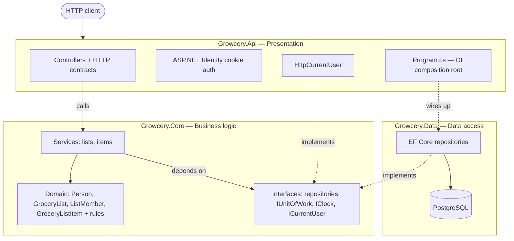
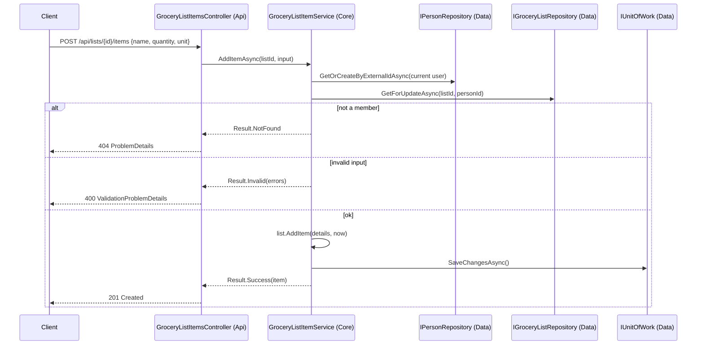
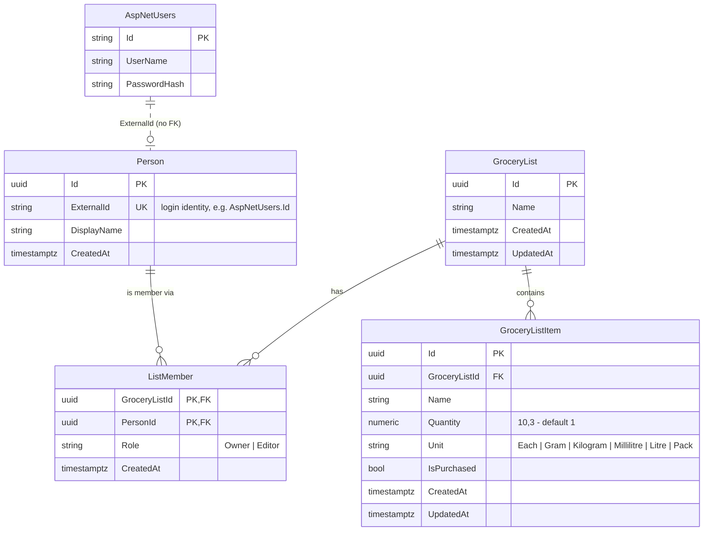

# Growcery

Growcery is a grocery list API. A signed-in person creates shopping lists and **captures** what they need to buy:
each item has a name, a quantity and a standard unit, and can be ticked off when it's bought.

The long-term goal is an "intelligent" shopping assistant that learns from what people buy, suggests items, and
compares live prices from retailers. Today's data model is designed with that in mind (see [Roadmap](#roadmap)).

> **This README is the living overview.** It describes the app as it is now. The decisions behind each feature are in
> [`docs/specs/`](docs/specs/), and the rules for working in the code are in [`AGENTS.md`](AGENTS.md).

---

## What it does today

| Feature | Endpoints | Spec |
|---|---|---|
| Accounts (register, log in with a cookie) | `POST /api/account/register`, `POST /api/account/login` | — |
| Grocery lists: create (name optional), view, rename, delete | `GET/POST /api/lists`, `GET/PUT/DELETE /api/lists/{id}` | [001](docs/specs/001-grocery-list-capture-crud.md), [002](docs/specs/002-layered-architecture.md) |
| List items: add, view, edit, tick off, remove | `GET/POST /api/lists/{listId}/items`, `GET/PUT/DELETE /api/lists/{listId}/items/{itemId}` | [001](docs/specs/001-grocery-list-capture-crud.md), [002](docs/specs/002-layered-architecture.md) |

**Key behaviour:**
- Every list endpoint requires login. Signing in creates the caller's `Person` automatically.
- Access to a list is through **membership**. A list you're not a member of returns `404`.
- A blank list name becomes `Shopping list 25 Oct 2026` (the creation date).
- Items default to quantity `1` and unit `Each`. The units are `Each`, `Gram`, `Kilogram`, `Millilitre`, `Litre` and
  `Pack`. Duplicate item names are allowed.
- Deleting a list deletes it and its items permanently.
- All errors are RFC 9457 ProblemDetails (`application/problem+json`).

---

## Architecture

Growcery is a layered monolith with three projects. Dependencies point **into** the business layer, which knows
nothing about ASP.NET, EF Core or PostgreSQL (Inversion of Control).

| Project | Layer | Responsibility | May depend on |
|---|---|---|---|
| [`src/Growcery.Api`](src/Growcery.Api) | Presentation | Routes, HTTP contracts, auth, translating results to status codes | Core, Data (for DI wiring only) |
| [`src/Growcery.Core`](src/Growcery.Core) | Business | Domain entities, validation rules, services, and the interfaces other layers implement | Nothing technical (only `Microsoft.Extensions.*.Abstractions`) |
| [`src/Growcery.Data`](src/Growcery.Data) | Data | EF Core mappings, repositories, migrations, Identity tables | Core |
| [`tests/Growcery.Core.Tests`](tests/Growcery.Core.Tests) | — | Fast unit tests of the business rules, using in-memory fakes | Core |
| [`tests/Growcery.Api.Tests`](tests/Growcery.Api.Tests) | — | Integration tests through HTTP | Api |

**Why this shape:**
- To replace PostgreSQL or EF Core, write a new Data project that implements Core's interfaces.
- To replace ASP.NET (e.g. with a different host or a message handler), write a new presentation project that calls
  the same services.
- In both cases, Core and its tests don't change.

### How a request flows

### Class diagram

`GroceryListItemService` depends on the same five interfaces as `GroceryListService`. Only one arrow is drawn to keep
the diagram readable.

---

## Data model (ERD)

- **People and logins are separate.** `Person` is the business's view of a user. `AspNetUsers` belongs to ASP.NET
  Identity and is linked only through `Person.ExternalId`, with **no foreign key**. A different identity provider
  (e.g. Entra ID) could replace Identity without changing the domain tables.
- **Membership controls access.** The person who creates a list becomes its `Owner`. The `Editor` role is reserved for
  list sharing, which isn't built yet.
- **Deletes are the same in the app and the database.** Deleting a list cascades to its items and memberships. A
  `Person` is never deleted by the app, so the database restricts it.
- The other Identity tables (`AspNetRoles`, `AspNetUserClaims`, …) are standard ASP.NET Identity and aren't shown.

---

## Running it

You need:
- the [.NET 10 SDK](https://dotnet.microsoft.com/download)
- Docker Desktop, running

| Task | Command |
|---|---|
| Run the API + PostgreSQL | `docker compose up` → http://localhost:3030/swagger |
| Stop | `docker compose down` (add `-v` to wipe the local database) |
| Build and test | `dotnet build` · `dotnet test` (no Docker needed) |
| Add a migration | `dotnet tool restore`, then `dotnet ef migrations add <Name> --project src/Growcery.Data --startup-project src/Growcery.Api` |

In Development, migrations are applied automatically on startup. Other environments apply them with an idempotent
script (see [spec 001 §7](docs/specs/001-grocery-list-capture-crud.md#7-deployment-and-migrations)).

**Trying it in Swagger:**
1. `POST /api/account/register` with a username and password (e.g. `P@ssw0rd123!`). The login cookie is stored in your
   browser.
2. `POST /api/lists` with `{}` to create a list with the default name.
3. `POST /api/lists/{id}/items` with `{ "name": "Milk", "quantity": 2, "unit": "Litre" }`.

> **Windows tip:** if a local PostgreSQL install is also listening on port 5432, `localhost:5432` reaches it instead of
> the Docker database. Running everything through `docker compose` avoids this.

**Hosting target:** Azure Container Apps, using the same Docker image. HTTPS ends at the ingress, so outside
Development the login cookie is always `Secure`.

---

## Testing

- **`Growcery.Core.Tests`** tests the business rules directly, with hand-written in-memory fakes of the repository,
  clock and current-user interfaces. These tests need no database and no web server, and run in about 0.1 s.
- **`Growcery.Api.Tests`** sends real HTTP requests to the app (`WebApplicationFactory`, with EF InMemory in place of
  PostgreSQL). It covers routes, status codes, auth, and that one person can't see another person's lists.
- Work is test-first. See [`AGENTS.md` §8](AGENTS.md#8-testing-rules-test-first).

---

## Specs and decisions

| Spec | What | Status |
|---|---|---|
| [001 — Grocery list capture](docs/specs/001-grocery-list-capture-crud.md) | First CRUD API, auth behaviour, error format, security, deployment notes | Implemented, partly superseded by 002 |
| [002 — Layered architecture](docs/specs/002-layered-architecture.md) | Api/Core/Data split, `Person` + membership, review-driven product changes | Implemented |

---

## Roadmap

These are designed for, but not built yet (spec 002 §7):
- **List sharing:** invite people as `Editor` members. Access checks already use membership.
- **Product catalogue:** items gain an optional `ProductId`, and the typed name is kept.
- **Live retailer pricing:** a price-provider interface in Core, implemented per retailer.
- **AI suggestions:** a suggestion-service interface in Core, using each person's list history.

**Known gaps before production:**
- the `NU1903` vulnerability in a Swagger dependency
- Data Protection key storage for the login cookie (spec 001 D10)
- a deployment pipeline
- screen mockups for a future frontend
