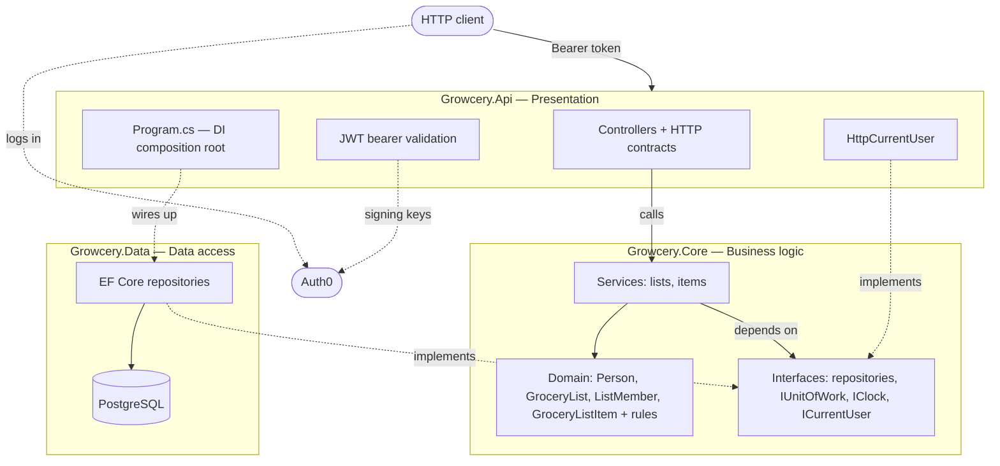
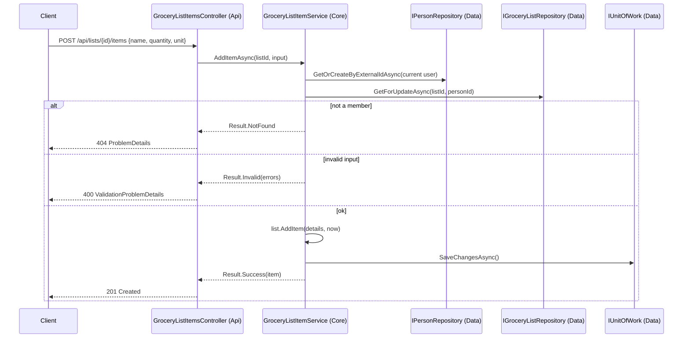
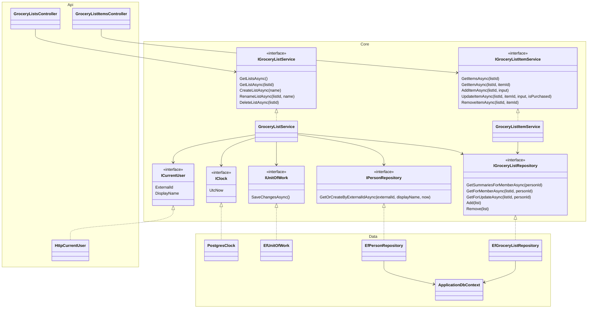
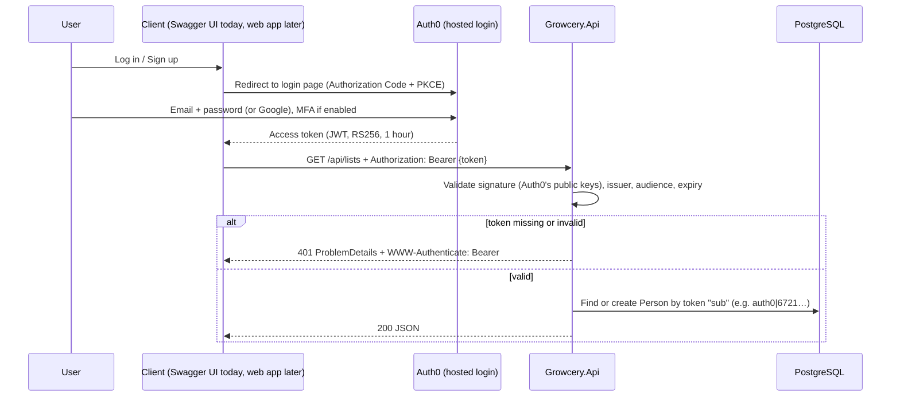
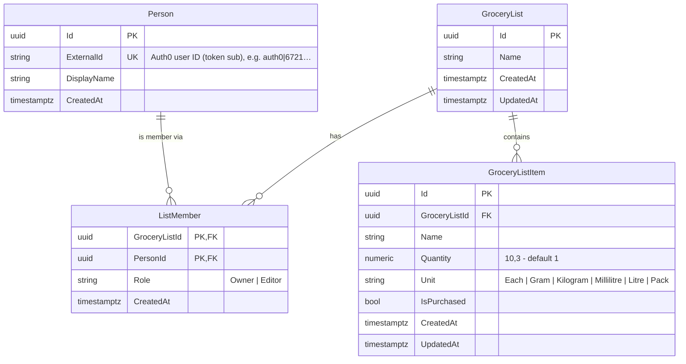

# Growcery

Growcery is a grocery list API. A signed-in person creates shopping lists and **captures** what they need to buy:
each item has a name, a quantity and a standard unit, and can be ticked off when it's bought.

The long-term goal is an "intelligent" shopping assistant that learns from what people buy, suggests items, and
compares live prices from retailers. Today's data model is designed with that in mind (see [Roadmap](#roadmap)).

> **This README is the living overview.** It describes the app as it is now. The decisions behind each feature are in
> [`docs/specs/`](docs/specs/), and the rules for working in the code are in [`AGENTS.md`](AGENTS.md).

---

## What it does today

| Feature | Endpoints | Spec |
|---|---|---|
| Sign-up, login, password reset | None in the API: they happen on **Auth0's hosted login page** (see [Authentication](#authentication)) | [003](docs/specs/003-auth0-authentication.md) |
| Grocery lists: create (name optional), view, rename, delete | `GET/POST /api/lists`, `GET/PUT/DELETE /api/lists/{id}` | [001](docs/specs/001-grocery-list-capture-crud.md), [002](docs/specs/002-layered-architecture.md) |
| List items: add, view, edit, tick off, remove | `GET/POST /api/lists/{listId}/items`, `GET/PUT/DELETE /api/lists/{listId}/items/{itemId}` | [001](docs/specs/001-grocery-list-capture-crud.md), [002](docs/specs/002-layered-architecture.md) |

**Key behaviour:**
- Every list endpoint requires an Auth0 access token (`Authorization: Bearer …`). A user's first call creates their
  `Person` automatically.
- Access to a list is through **membership**. A list you're not a member of returns `404`.
- A blank list name becomes `Shopping list 25 Oct 2026` (the creation date).
- Items default to quantity `1` and unit `Each`. The units are `Each`, `Gram`, `Kilogram`, `Millilitre`, `Litre` and
  `Pack`. Duplicate item names are allowed.
- Deleting a list deletes it and its items permanently.
- All errors are RFC 9457 ProblemDetails (`application/problem+json`).

---

## Architecture

Growcery is a layered monolith with three projects. Dependencies point **into** the business layer, which knows
nothing about ASP.NET, EF Core or PostgreSQL (Inversion of Control).



| Project | Layer | Responsibility | May depend on |
|---|---|---|---|
| [`src/Growcery.Api`](src/Growcery.Api) | Presentation | Routes, HTTP contracts, auth, translating results to status codes | Core, Data (for DI wiring only) |
| [`src/Growcery.Core`](src/Growcery.Core) | Business | Domain entities, validation rules, services, and the interfaces other layers implement | Nothing technical (only `Microsoft.Extensions.*.Abstractions`) |
| [`src/Growcery.Data`](src/Growcery.Data) | Data | EF Core mappings, repositories, migrations | Core |
| [`tests/Growcery.Core.Tests`](tests/Growcery.Core.Tests) | — | Fast unit tests of the business rules, using in-memory fakes | Core |
| [`tests/Growcery.Api.Tests`](tests/Growcery.Api.Tests) | — | Integration tests through HTTP | Api |

**Why this shape:**
- To replace PostgreSQL or EF Core, write a new Data project that implements Core's interfaces.
- To replace ASP.NET (e.g. with a different host or a message handler), write a new presentation project that calls
  the same services.
- In both cases, Core and its tests don't change.

### How a request flows



### Class diagram



`GroceryListItemService` depends on the same five interfaces as `GroceryListService`. Only one arrow is drawn to keep
the diagram readable.

---

## Authentication

Identity is handled entirely by **[Auth0](https://auth0.com)** ([spec 003](docs/specs/003-auth0-authentication.md)).
Users sign up, log in, reset passwords and use MFA or Google login on **Auth0's hosted login page**. The API is a
*resource server* only. It never sees passwords, issues no tokens and sets no cookies. It only checks that each
request carries a valid **access token** that Auth0 issued for this API.



- **Who's calling:** `HttpCurrentUser` reads the token's `sub` claim (the Auth0 user ID) as `Person.ExternalId`. It
  reads the display name from the custom `https://growcery.app/name` claim, falling back to `sub`.
- **Configuration** (not secrets): `Auth0:Domain`, `Auth0:Audience` and, for Swagger, `Auth0:SwaggerClientId`. The
  app refuses to start if the domain or audience is missing.
- **Tests never call Auth0.** They sign their own tokens with a test key (`TestTokens`).

### Auth0 setup (once per tenant)

There's one tenant per environment: **dev** now, **prod** when hosting is decided. In the
[Auth0 dashboard](https://manage.auth0.com):

1. **Create a tenant** on the Free plan (e.g. `growcery-dev`, EU region).
2. **Applications → APIs → Create API:** name `Growcery API`, identifier **`https://api.growcery.local`** (the
   audience in `appsettings.json`; it doesn't need to resolve), signing algorithm **RS256**. Then, in its
   **Settings → Token Settings**, set **both** **Maximum Access Token Lifetime** and **Implicit / Hybrid Flow Access
   Token Lifetime** to **3600** seconds. If only the first is changed, Auth0 rejects the save with
   `token_lifetime_for_web cannot be larger than token_lifetime`.
3. **Applications → Create Application → Single Page Application**, named `Growcery Swagger`. In **Settings**:
   - Allowed Callback URLs: `http://localhost:3030/swagger/oauth2-redirect.html, https://localhost:7220/swagger/oauth2-redirect.html`
   - Allowed Web Origins: `http://localhost:3030, https://localhost:7220`
   - Leave **Credentials → Authentication Method** as **None** (a public client: no secret, PKCE instead).
4. **Let the app get tokens for the API:** **Applications → APIs → Growcery API → Application Access**. Under
   **User Access**, authorize **Growcery Swagger**, or set the policy to **Allow**. Without this, Swagger's login
   fails with `Client "…" is not authorized to access resource server "https://api.growcery.local"`.
5. **Authentication → Database:** make sure `Username-Password-Authentication` is enabled for the SPA (its
   **Connections** tab). Social connections (e.g. Google) are optional.
6. **Actions → Library → Build Custom** (trigger *Login / Post Login*), then deploy and add it to the **Post Login**
   flow:
   ```js
   exports.onExecutePostLogin = async (event, api) => {
     api.accessToken.setCustomClaim("https://growcery.app/name", event.user.name);
   };
   ```
7. **Fill in `src/Growcery.Api/appsettings.Development.json`:**
   ```json
   "Auth0": { "Domain": "growcery-dev.eu.auth0.com", "SwaggerClientId": "<SPA Client ID>" }
   ```
   These are identifiers, not secrets. Never commit a client **secret** or a Management API token.
8. **Check the network:** `https://<your-domain>/.well-known/openid-configuration` should open in a browser. If a
   corporate proxy blocks it, the API can't download Auth0's signing keys.

> **Dashboard says "You don't have permissions to access the resource" when saving?** Try an incognito window. A
> browser extension or an old Auth0 session can cause it. Clearing the `auth0.com` cookies, or disabling extensions
> for `manage.auth0.com`, fixes the normal window.

---

## Data model (ERD)



- **People and logins are separate.** `Person` is the business's view of a user. Logins live in Auth0, linked only
  through `Person.ExternalId` (the token's `sub`). The database holds no user or password tables.
- **Membership controls access.** The person who creates a list becomes its `Owner`. The `Editor` role is reserved for
  list sharing, which isn't built yet.
- **Deletes are the same in the app and the database.** Deleting a list cascades to its items and memberships. A
  `Person` is never deleted by the app, so the database restricts it.

---

## Running it

You need:
- the [.NET 10 SDK](https://dotnet.microsoft.com/download)
- Docker Desktop, running
- an Auth0 dev tenant, set up as in [Auth0 setup](#auth0-setup-once-per-tenant). The API won't start without it.

> **Upgrading from the cookie-auth version?** Reset your local database once with `docker compose down -v`. The old
> `Person` rows point to the removed `AspNetUsers` table (spec 003 D23).

| Task | Command |
|---|---|
| Run the API + PostgreSQL | `docker compose up` → http://localhost:3030/swagger |
| Stop | `docker compose down` (add `-v` to wipe the local database) |
| Build and test | `dotnet build` · `dotnet test` (no Docker needed) |
| Add a migration | `dotnet tool restore`, then `dotnet ef migrations add <Name> --project src/Growcery.Data --startup-project src/Growcery.Api` |

In Development, migrations are applied automatically on startup. Other environments apply them with an idempotent
script (see [spec 001 §7](docs/specs/001-grocery-list-capture-crud.md#7-deployment-and-migrations)).

**Trying it in Swagger:**
1. Click **Authorize**. In the `auth0` dialog, `client_id` is pre-filled. **Leave `client_secret` empty** (PKCE is
   used instead), then click **Authorize**. Auth0's login page opens. Sign up (first time) or
   log in. You're sent back to Swagger with an access token, which it now sends on every call.
2. `POST /api/lists` with `{}` to create a list with the default name.
3. `POST /api/lists/{id}/items` with `{ "name": "Milk", "quantity": 2, "unit": "Litre" }`.

After an hour the token expires and calls return `401`. Click **Authorize** again to get a new one.

> **Windows tip:** if a local PostgreSQL install is also listening on port 5432, `localhost:5432` reaches it instead of
> the Docker database. Running everything through `docker compose` avoids this.

**Hosting target:** Azure Container Apps, using the same Docker image. HTTPS ends at the ingress. Production will use
its own Auth0 tenant, configured through `Auth0__Domain`.

---

## Testing

- **`Growcery.Core.Tests`** tests the business rules directly, with hand-written in-memory fakes of the repository,
  clock and current-user interfaces. These tests need no database and no web server, and run in about 0.1 s.
- **`Growcery.Api.Tests`** sends real HTTP requests to the app (`WebApplicationFactory`, with EF InMemory in place of
  PostgreSQL). It covers routes, status codes, token validation (expired, wrong audience or issuer, bad signature,
  unsigned), and that one person can't see another person's lists. Tokens are signed with a test key, so no Auth0
  account or network access is needed.
- Work is test-first. See [`AGENTS.md` §8](AGENTS.md#8-testing-rules-test-first).

---

## Specs and decisions

| Spec | What | Status |
|---|---|---|
| [001 — Grocery list capture](docs/specs/001-grocery-list-capture-crud.md) | First CRUD API, error format, security, deployment notes | Implemented, partly superseded by 002 and 003 |
| [002 — Layered architecture](docs/specs/002-layered-architecture.md) | Api/Core/Data split, `Person` + membership, review-driven product changes | Implemented (auth parts superseded by 003) |
| [003 — Auth0 authentication](docs/specs/003-auth0-authentication.md) | Identity moved to Auth0. The API validates JWT access tokens, and ASP.NET Identity is removed | Implemented |

---

## Roadmap

These are designed for, but not built yet (spec 002 §7):
- **List sharing:** invite people as `Editor` members. Access checks already use membership.
- **Product catalogue:** items gain an optional `ProductId`, and the typed name is kept.
- **Live retailer pricing:** a price-provider interface in Core, implemented per retailer.
- **AI suggestions:** a suggestion-service interface in Core, using each person's list history.

**Known gaps before production:**
- the `NU1903` vulnerability in a Swagger dependency
- a production Auth0 tenant (spec 003 D24)
- a deployment pipeline
- screen mockups for a future frontend
