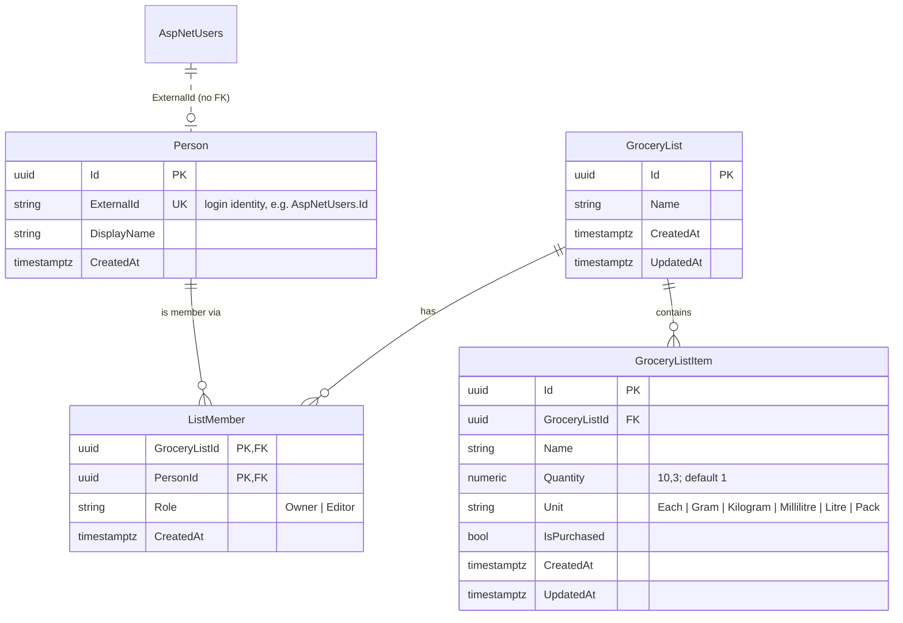

# Spec 002 — Layered architecture (Presentation / Business / Data)

| Field    | Value                                   |
|----------|-----------------------------------------|
| Status   | **In progress** |
| Branch   | `feature/grocery-list-capture-crud` (same PR as spec 001, #6) |
| Scope    | Restructure into layers + the product changes from the PR #6 review |
| Depends  | Spec 001 (grocery list capture) |

> **For AI agents and developers:** Follow the repo rules in [`/AGENTS.md`](../../AGENTS.md). This spec defines
> **what** to change. AGENTS.md defines **how**.

---

## 1. Goal

The PR #6 review found that the business logic was tied to ASP.NET MVC and EF Core: controllers injected
`ApplicationDbContext` and `UserManager` directly. This spec splits the app into three layers that talk only through
interfaces (Inversion of Control + the Repository pattern). The aim is that the web framework or the database can be
replaced without touching the business logic.

It also applies the product decisions made in response to the review (§6). Spec 001's API changes accordingly.

### In scope
- Separate projects for the Presentation, Business and Data layers, plus a unit test project for the business layer.
- A domain `Person` entity that's decoupled from ASP.NET Identity, and list membership (`ListMember`).
- The product changes in §6 (D11–D15).
- A living root `README.md` with an ERD and a class diagram.

### Out of scope
- Sharing endpoints (inviting people to a list). The data model supports it, but no API exposes it yet.
- A product catalogue, retailer pricing and the AI layer (§7 lists the extension points left for them).
- Abstracting authentication. `AccountController` keeps using ASP.NET Identity, because auth belongs to the
  presentation layer.
- Screen mockups (the review asked for them; deferred).

---

## 2. Architecture

```
            ┌──────────────────────────┐
            │  Growcery.Api            │  Presentation: controllers, auth, HTTP contracts,
            │  (ASP.NET Core)          │  DI composition root (Program.cs)
            └───────┬──────────┬───────┘
                    │ uses     │ wires up (DI only)
                    ▼          ▼
┌──────────────────────────┐  ┌──────────────────────────┐
│  Growcery.Core           │◄─│  Growcery.Data           │  Data: EF Core + Npgsql, Identity stores,
│  Business: domain, rules,│  │  implements Core's       │  repositories, migrations
│  services, interfaces    │  │  interfaces              │
└──────────────────────────┘  └──────────────────────────┘
```

**Dependency rule:** every dependency points **into** Core, and Core depends on nothing technical.

| Project | References | May use |
|---|---|---|
| `src/Growcery.Core` | — | Only `Microsoft.Extensions.*.Abstractions` packages (DI and logging abstractions). **No** ASP.NET Core, **no** EF Core |
| `src/Growcery.Data` | Core | EF Core, Npgsql, Identity EF stores |
| `src/Growcery.Api` | Core, Data | ASP.NET Core, Identity, Swashbuckle. Data is referenced **only** for DI wiring in `Program.cs` |
| `tests/Growcery.Core.Tests` | Core | xUnit and hand-written in-memory fakes. No database, no HTTP |
| `tests/Growcery.Api.Tests` | Api | xUnit, `WebApplicationFactory`, EF InMemory (the existing integration tests) |

**Swapping technology:** a different database or ORM means a new Data project implementing the same interfaces. A
different web framework means a new presentation project calling the same services. Core doesn't change in either
case.

### 2.1 Core (`Growcery.Core`)
- `Domain/`: entities with behaviour, and no persistence attributes (§3).
- `Abstractions/`:
  - `IGroceryListRepository`
  - `IPersonRepository`
  - `IUnitOfWork` (`SaveChangesAsync`)
  - `IClock` (`UtcNow`)
  - `ICurrentUser` (`ExternalId`, `DisplayName`), which identifies the signed-in user without knowing how they signed in.
- `Services/`: `IGroceryListService` and `IGroceryListItemService`, plus their implementations.
  - They resolve the current `Person` through `IPersonRepository.GetOrCreateByExternalIdAsync`, so a `Person` is
    created the first time a user calls the API. This works the same with any identity provider (cookie, Entra ID,
    etc.).
  - They check access through `ListMember`. Only the `Owner` may rename or delete a list. Any member may read and
    change items.
  - They return `Result` / `Result<T>`: `Ok`, `NotFound`, `Forbidden` (a member who isn't the Owner tries to rename
    or delete), or `Invalid` (errors keyed by camelCase field name). There are no HTTP types in Core.
- **Business rules (validation) live in Core, once.** API request models no longer carry validation attributes.
- `DependencyInjection.AddGrowceryCore(IServiceCollection)` registers the services.

### 2.2 Data (`Growcery.Data`)
- `ApplicationDbContext : IdentityDbContext<ApplicationUser>`, with one `IEntityTypeConfiguration<T>` per domain
  entity. `ApplicationUser` moves here.
- Repositories: `EfGroceryListRepository`, `EfPersonRepository`, `EfUnitOfWork`.
  - Read-only queries use `AsNoTracking()`. EF then doesn't keep a change-tracking snapshot of entities that won't
    be saved, which makes reads cheaper.
  - `EfPersonRepository` handles the race where two first requests create the same `Person`. It catches the Postgres
    unique violation on `ExternalId` and reloads. The Postgres-specific detail stays in Data.
- `PostgresClock : IClock` returns UTC truncated to microseconds, matching `timestamptz`.
- `DependencyInjection.AddGrowceryData(IServiceCollection, string connectionString)`.
- `Migrations/` (see §5).

### 2.3 Api (`Growcery.Api`)
- `GroceryListsController` and `GroceryListItemsController` inject **only** Core service interfaces.
- `HttpCurrentUser : ICurrentUser` reads `ClaimTypes.NameIdentifier` and `ClaimTypes.Name` from the request.
- `ResultExtensions.ToActionResult()` maps results to HTTP:
  - `NotFound` → `404` ProblemDetails
  - `Forbidden` → `403` ProblemDetails (only reachable once sharing adds Editors)
  - `Invalid` → `400` `ValidationProblemDetails`
  - `Ok` → `200`/`201`/`204`
- Request and response contracts (`Contracts/`). `UnitOfMeasure` is serialized as a string.
- `AccountController` and the cookie/ProblemDetails setup from spec 001 §5 stay as they are.

---

## 3. Domain model



| Rule | Value |
|---|---|
| List `Name` | Optional. Trimmed, max 100. If blank, defaults to `Shopping list {d MMM yyyy}` (invariant culture, UTC date), e.g. `Shopping list 25 Oct 2026` (D13) |
| Item `Name` | Required, 1–100 characters after trimming. **Not unique**, so duplicates are allowed (D11) |
| Item `Quantity` | Optional, default `1`. Must be > 0 with at most **3** decimal places, so `0.125` kg works (D14) |
| Item `Unit` | Optional, default `Each`. One of `Each, Gram, Kilogram, Millilitre, Litre, Pack`. Stored as a string, so new values can be added without a data migration (D14) |
| `ListMember.Role` | `Owner` (the creator) or `Editor` (reserved for sharing). Stored as a string (D15) |
| `Person.ExternalId` | Unique. It links to the identity provider's user ID **without a foreign key**, so the domain never depends on ASP.NET Identity's tables (D15) |
| Timestamps | From `IClock`. `GroceryList.UpdatedAt` changes on rename and on any item change |

**Delete behaviour is the same in the app and the database:**
- Deleting a list removes the list, its items and its memberships. The database cascades `GroceryList → GroceryListItem`
  and `GroceryList → ListMember` to match (D12).
- A `Person` is never deleted by the app, so `Person → ListMember` is `Restrict`.

---

## 4. API contract (replaces spec 001 §4 where they differ)

There are 10 endpoints, all of which require auth. Lists you're not a member of return `404`. All errors are
ProblemDetails.

| Method | Route | Body | Success | Errors |
|---|---|---|---|---|
| `GET` | `/api/lists` | — | `200` `GroceryListSummaryResponse[]` (lists the caller is a member of), ordered by `UpdatedAt` desc, then `Id` | `401` |
| `GET` | `/api/lists/{id}` | — | `200` `GroceryListResponse` | `401`, `404` |
| `POST` | `/api/lists` | `{ "name"?: string }` | `201` `GroceryListResponse` + `Location` | `400`, `401`, `415` |
| `PUT` | `/api/lists/{id}` | `{ "name"?: string }` (blank resets to the default name) | `200` `GroceryListResponse` | `400`, `401`, `404`, `415` |
| `DELETE` | `/api/lists/{id}` | — | `204` (hard delete) | `401`, `404` |
| `GET` | `/api/lists/{listId}/items` | — | `200` `GroceryListItemResponse[]` ordered by `CreatedAt`, then `Id` | `401`, `404` |
| `GET` | `/api/lists/{listId}/items/{itemId}` | — | `200` `GroceryListItemResponse` | `401`, `404` |
| `POST` | `/api/lists/{listId}/items` | `{ "name": string, "quantity"?: number, "unit"?: string }` | `201` `GroceryListItemResponse` + `Location` | `400`, `401`, `404`, `415` |
| `PUT` | `/api/lists/{listId}/items/{itemId}` | `{ "name": string, "quantity"?: number, "unit"?: string, "isPurchased": bool }` | `200` `GroceryListItemResponse` | `400`, `401`, `404`, `415` |
| `DELETE` | `/api/lists/{listId}/items/{itemId}` | — | `204` | `401`, `404` |

```csharp
public sealed record GroceryListSummaryResponse(Guid Id, string Name, int ItemCount, int PurchasedCount,
    DateTimeOffset CreatedAt, DateTimeOffset UpdatedAt);
public sealed record GroceryListResponse(Guid Id, string Name, IReadOnlyList<GroceryListItemResponse> Items,
    DateTimeOffset CreatedAt, DateTimeOffset UpdatedAt);
public sealed record GroceryListItemResponse(Guid Id, Guid GroceryListId, string Name, decimal Quantity,
    UnitOfMeasure Unit, bool IsPurchased, DateTimeOffset CreatedAt, DateTimeOffset UpdatedAt);
```

- **Removed from spec 001:**
  - `GET /api/lists/deleted` and `POST /api/lists/{id}/restore`
  - the `409` duplicate-name responses
  - the `deletedAt` and `notes` fields
- An unknown `unit` value returns `400` with an error on `unit`.

---

## 5. Migrations
- Migrations move to `src/Growcery.Data/Migrations`.
- `InitialCreate` (already on `main`) gets **only** a mechanical namespace change. The proof is that
  `dotnet ef migrations script 0 InitialCreate` produces identical SQL before and after the move.
- The unmerged `AddGroceryLists` migration (spec 001, never on `main`) is **deleted and replaced** by one new
  migration, `AddGroceryDomain`. This doesn't break AGENTS.md §6, which only protects migrations that are on `main`.
- **Local dev databases** that already applied `AddGroceryLists` must be reset once: `docker compose down -v`.
- EF commands now name the projects:
  `dotnet ef migrations add <Name> --project src/Growcery.Data --startup-project src/Growcery.Api`.

---

## 6. Decisions

Product decisions from the PR #6 review (2026-10-25). They supersede spec 001's D1 and D2.

- **D11 — Duplicate item names are allowed** (supersedes spec 001 D1). Removing a duplicate costs the user one tap.
  Enforcing uniqueness cost a column, an index, race handling and tests, and it would get in the way of shared lists.
  `NormalizedName` and its unique index are removed.
- **D12 — Lists are hard-deleted, with no restore** (supersedes spec 001 D2). No user need was found for browsing or
  restoring deleted lists. This also makes the database's delete behaviour match the app's (review comment on
  `ApplicationDbContext`), and removes the indefinite retention flagged in spec 001 D9.
- **D13 — The list name is optional.** If it's blank, the server sets a date-based default, so starting a list has no
  friction. The user can rename it later.
- **D14 — Items have structured quantity and unit.** The long-term goal is an "intelligent" app (an AI layer that
  learns, live retailer pricing, standard units). So an item is a line item: `Name` + `Quantity` (decimal, default 1)
  + `Unit` (an enumerated standard unit, default `Each`). `Notes` is removed. Product preferences belong to the future
  catalogue (§7).
- **D15 — Domain `Person` + `ListMember`.** Users are domain `Person`s linked to the login only by `ExternalId`.
  Access to a list is through membership with a role. This is the reviewer's suggested "auth constraint for lists
  people have access to", and it makes list sharing an additive change later.
- **D16 — Three projects with inverted dependencies** (`Api → Core ← Data`), not top-down layering. Core defines the
  repository interfaces and Data implements them (Dependency Inversion).
- **D17 — Users are created lazily.** A `Person` is created the first time an authenticated user calls the API, not at
  registration. This keeps account registration (Identity) and the domain independent.

---

## 7. Extension points for the roadmap (not built)
- **Product catalogue:** `GroceryListItem` gains a nullable `ProductId`. The free-text `Name` stays as what the user
  typed.
- **Live pricing:** a new `IPriceProvider` interface in Core, implemented per retailer in a new infrastructure project.
- **AI suggestions:** a new `ISuggestionService` interface in Core. Membership and item history give it per-person
  data.
- **Sharing:** endpoints to add `ListMember` rows with the `Editor` role. Access checks already use membership.

---

## 8. Implementation plan

One commit per step, test-first (AGENTS.md §7), and `dotnet test` passes before each commit.

1. **Docs:** this spec, spec 001 amendments and AGENTS.md rules.
2. **Restructure only:** move the code into the five projects (`git mv`). Update the solution, namespaces,
   `Dockerfile`, `docker-compose.yml` and CI. Behaviour is unchanged, and all existing tests stay green.
3. **Core:** domain, rules, abstractions and services, driven by `Growcery.Core.Tests`.
4. **Data** and 5. **Api**, in **one commit**. As soon as the database maps the domain entities, the old controllers no
   longer compile, so splitting them would leave a commit with a broken build.
   - Data: configurations, repositories, `PostgresClock`, and the `AddGroceryDomain` migration (reviewed).
   - Api: controllers through the services, `HttpCurrentUser` and result mapping.
   - Integration tests updated for §4. Tests for removed behaviour (duplicate names, soft delete, restore,
     `MaxDecimalPlacesAttribute`) are deleted under D11/D12/D14. Code that's no longer used is removed.
6. **README:** purpose, architecture, ERD, class diagram, how to run and test, roadmap, and spec index.
7. **Verify:**
   - Fresh database, Swagger and a curl smoke test against Postgres.
   - Draft replies to the review comments, and update the PR description.

---

## 9. Definition of done
- [ ] `Growcery.Core` has no reference to ASP.NET Core or EF Core (no package references, no `using`).
- [ ] Grocery controllers inject only Core service interfaces.
- [ ] All 10 endpoints match §4, and access is enforced through membership (covered by tests).
- [ ] Business rules are covered by `Growcery.Core.Tests` unit tests that don't use a database.
- [ ] `InitialCreate` SQL is unchanged, and `AddGroceryDomain` applies to a fresh PostgreSQL database.
- [ ] `docker compose up` works with the new layout. Swagger shows the endpoints.
- [ ] `dotnet build` has no new warnings, and `dotnet test` passes locally and in CI.
- [ ] `README.md` explains the purpose and architecture, with the ERD and class diagram.
- [ ] Spec 001 and AGENTS.md are updated to match.

---

## 10. Changelog

| Date | Change |
|---|---|
| 2026-10-25 | Initial spec, from the PR #6 review. D11–D17. |
